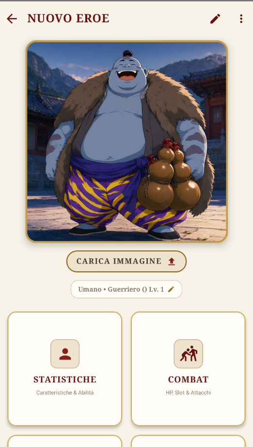
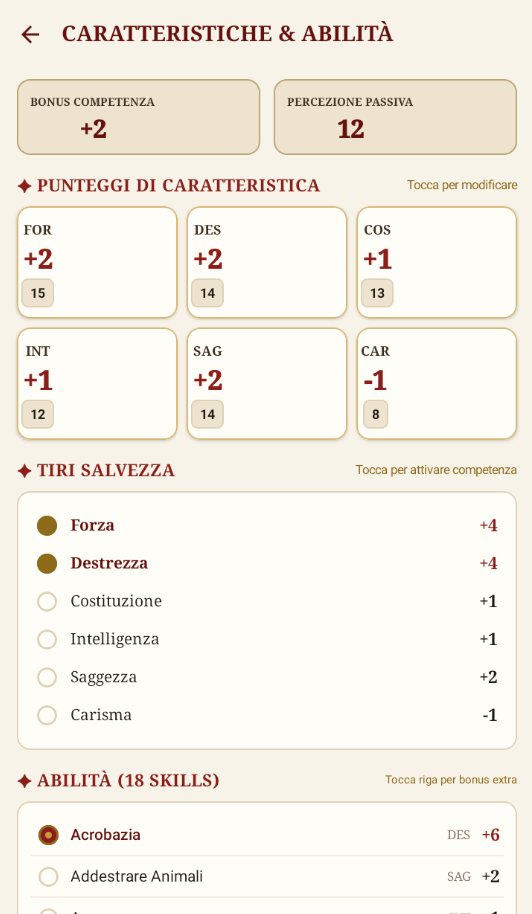
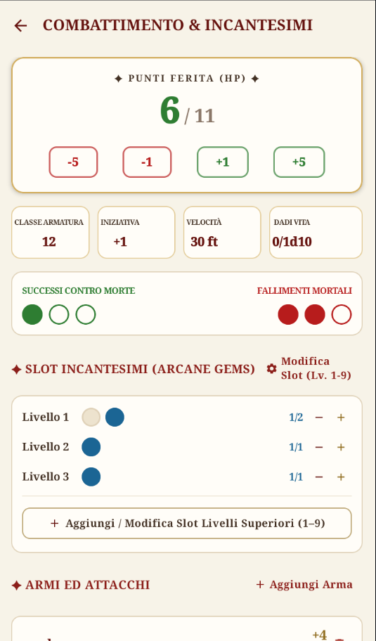

# ⚔️ PocketSheet — D&D 5e Portable Character Sheet

<p align="center">
  
</p>

<p align="center">
  <b>La tua scheda personaggio per Dungeons & Dragons 5e sempre con te su Android.</b><br>
  Un'applicazione mobile nativa, leggera e reattiva con interfaccia high-fantasy ispirata ai manuali D&D, calcoli matematici 5e automatici, gestione slot incantesimi e supporto completo per importazione ed esportazione JSON.<br>
  Sviluppato da <a href="https://github.com/Gryve"><b>Gryve</b></a>.
</p>

---

## 📱 Screenshot dell'App

| Panoramica Personaggio | Caratteristiche & Abilità | Combattimento & Incantesimi |
| :---: | :---: | :---: |
|  |  |  |
| Ritratto, classe/livello e accesso rapido alle sezioni | Modificatori, tiri salvezza e 18 abilità a 3 stati | Tracker HP, tiri contro la morte e slot incantesimi (Arcane Gems) |

---

## 🌟 Caratteristiche Principali

* 📜 **Importazione & Esportazione JSON**:
  * Compatibilità nativa al 100% con i file esportati dall'app companion [SheetMaker](https://github.com/Gryve/SheetMaker) (es. `Elandor_Dawnwhisper_5e.json`).
  * Esporta e condividi in qualsiasi momento la tua scheda aggiornata in formato JSON standard tramite lo Storage Access Framework di Android.

* 🧙‍♂️ **Creazione Schede da Zero ("NUOVO EROE")**:
  * Crea un avventuriero completo direttamente nell'app inserendo Nome, Classe, Specie, Livello, Background, Allineamento e Caratteristiche.
  * **Calcolo automatico** iniziale di HP massimi (in base al dado vita di classe e Costituzione), Classe Armatura base e slot incantesimo per caster.

* ⚡ **Calcoli Automatici D&D 5e in Tempo Reale**:
  * **Modificatori di Caratteristica**: ricalcolo istantaneo ($\lfloor(\text{Score}-10)/2\rfloor$) per FOR, DES, COS, INT, SAG e CAR.
  * **Bonus di Competenza (PB)**: scala automaticamente al salire di livello (Liv. 1-4: $+2$, Liv. 5-8: $+3$, ecc.).
  * **Tiri Salvezza Cliccabili**: tocca qualsiasi caratteristica per attivare la competenza e ricalcolare all'istante il bonus totale.
  * **18 Abilità a 3 Stati**: tocca qualsiasi abilità per ciclare tra *Nessuna* (`○`), *Competente* (`◆` $+ \text{PB}$) e *Maestria / Expertise* (`◈` $+ 2\text{PB}$).
  * **Percezione Passiva**: calcolata e aggiornata in automatico su Saggezza e Competenza.

* ⚔️ **Combattimento Dinamico & Grimorio Incantesimi**:
  * **Tracker HP Hero**: contatore visuale con pulsanti rapidi $(-5, -1, +1, +5)$ e gestione HP Temporanei.
  * **Tiri Salvezza contro Morte**: indicatori grafici interattivi per 3 successi e 3 fallimenti.
  * **Gestione Completa Slot Incantesimi (Liv. 1–9)**: aggiungi slot di livello superiore (3, 4, ..., 9), modifica il numero di slot massimi per livello al volo o dal dialog dedicato, e consuma gli slot toccando le gemme zaffiro.
  * **Gestione Armi & Incantesimi**: aggiungi, modifica ed elimina attacchi personalizzati e formule magiche con note di gittata, componenti, concentrazione e rituali.

* 🎨 **Design High-Fantasy & Personalizzazione Grafica**:
  * Palette cromatica ufficiale D&D: *Rosso Draconico (Crimson)*, *Oro Antico*, *Pergamena* e *Cuoio*.
  * Tipografia classica con font Serif per titoli, nomi e caratteristiche.
  * **Ritrattista Eroe ("CARICA IMMAGINE")**: seleziona qualsiasi immagine dalla galleria del telefono tramite l'Android Photo Picker nativo e associala alla tua scheda con salvataggio locale persistente.

* 🎒 **Borsa delle Monete & Oggetti in Sintonia (Attunement)**:
  * Contatori dedicati per Rame (CP), Argento (SP), Electrum (EP), Oro (GP) e Platino (PP).
  * 3 slot di sintonizzazione per i tuoi oggetti magici preferiti.
  * Visualizzazione e modifica dell'inventario completo.

---

## 🏛️ Architettura & Stack Tecnologico

| Layer | Tecnologia |
| :--- | :--- |
| **Linguaggio** | [Kotlin](https://kotlinlang.org/) (Coroutines, Flow, StateFlow) |
| **UI Framework** | [Jetpack Compose](https://developer.android.com/jetpack/compose) + Material 3 |
| **Architettura** | Clean Architecture + MVVM (Model-View-ViewModel) |
| **Database Locale** | [Room Database](https://developer.android.com/training/data-storage/room) (SQLite) con migrazioni automatiche |
| **Serializzazione** | [Kotlinx Serialization](https://github.com/Kotlin/kotlinx.serialization) con serializer flessibili stringa/intero |
| **Image Loading** | [Coil Compose](https://coil-kt.github.io/coil/) per rendering e caching efficiente degli avatar locali |
| **File Picker & SAF** | Android Storage Access Framework (`OpenDocument`, `PickVisualMedia`) senza permessi invasivi |

---

## 🚀 Compilazione & Installazione

### Prerequisiti
* JDK 17+ (es. Oracle JDK 17 o OpenJDK)
* Android SDK (Target SDK 35, Min SDK 26)

### Comandi Gradle

```bash
# Esegui la suite completa di test unitari (12/12 test)
./gradlew testDebugUnitTest

# Compila l'APK di Debug
./gradlew assembleDebug
```

L'APK compilato sarà disponibile in:
```
app/build/outputs/apk/debug/app-debug.apk
```

---

## 🔗 Applicazione Companion: SheetMaker

PocketSheet dialoga perfettamente con [SheetMaker](https://github.com/Gryve/SheetMaker), l'applicazione web/desktop Python per PC creata da [Gryve](https://github.com/Gryve) che consente di compilare schede D&D 5.5e grafiche, generare PDF pronti per la stampa ed esportare il file `.json` da importare direttamente su smartphone in PocketSheet.

---

## 👤 Autore
Sviluppato da [Gryve](https://github.com/Gryve).
Distribuito per giocatori e master di D&D 5e / 5.5e.
